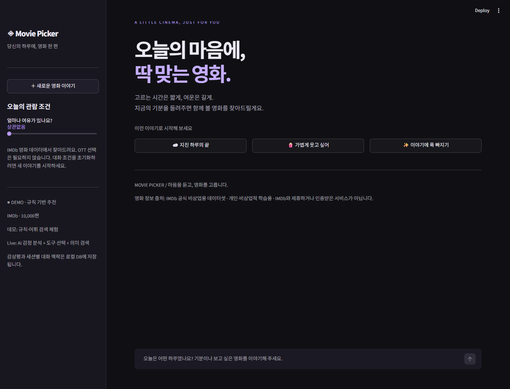
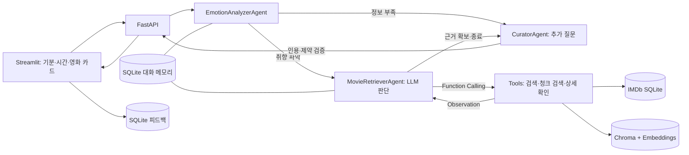

# Movie Picker 🎬

기분과 관람 조건을 바탕으로 IMDb 영화 데이터에서 추천하는 Python 웹 앱입니다. OTT 선택 없이 검색하며 추천 카드에서 IMDb 작품 페이지와 RAG 근거 청크를 확인할 수 있습니다.



## 빠른 실행 — Windows / Python 3.12

```powershell
cd movie-picker-ai
python -m venv .venv
.\.venv\Scripts\python.exe -m pip install -r requirements.txt
Copy-Item .env.example .env
.\.venv\Scripts\python.exe -m scripts.import_imdb
powershell -ExecutionPolicy Bypass -File .\start.ps1
```

이미 `.env`가 있다면 복사 단계를 건너뛰어 기존 키를 보존하세요. 이 작업 공간에는 `../.tools/python/python.exe`가 준비되어 있어 `.venv` 대신 사용할 수 있습니다.

- UI: http://localhost:8501
- API 문서: http://localhost:8000/docs
- 상태·데이터 준비 여부: http://localhost:8000/health

`start.ps1`는 API와 UI를 백그라운드 실행하고 PID를 출력합니다. 종료는 출력된 실제 PID를 `Stop-Process -Id <API번호>,<UI번호>`에 입력합니다. `.env`나 데이터 갱신 후 서버를 다시 시작하세요.

터미널 두 개에서 직접 실행할 수도 있습니다.

```powershell
# 터미널 1
.\.venv\Scripts\python.exe -m uvicorn app.api:app --host 127.0.0.1 --port 8000
# 터미널 2
.\.venv\Scripts\python.exe -m streamlit run streamlit_app.py --server.address=127.0.0.1
```

## IMDb 데이터 준비와 범위

[IMDb 공식 비상업용 데이터셋](https://developer.imdb.com/non-commercial-datasets/)의 `title.basics.tsv.gz`와 `title.ratings.tsv.gz`만 공식 다운로드 호스트에서 받습니다. IMDb 웹페이지를 자동 수집하지 않습니다.

```powershell
# 최초 다운로드·DB 구축 (압축 데이터 수백 MB, 처리 시간 필요)
python -m scripts.import_imdb
# 새 파일을 받아 갱신
python -m scripts.import_imdb --refresh
# 더 많은 작품을 보관
python -m scripts.import_imdb --max-movies 30000 --min-votes 1000
```

가져오기는 TSV 스트리밍 파싱 → `\N` 결측값 처리 → 비성인 장편 영화 필터 → IMDb ID로 평점 결합 → 투표 수 기준 선별 → SQLite 검색 DB 생성 순서입니다. 기본값은 1,000표 이상인 작품 중 투표가 많은 최대 10,000편입니다. 원본 전체를 검색하는 것은 아닙니다. 새 DB는 정상적으로 만들어진 경우에만 기존 DB와 교체합니다.

검색은 원제·대표 제목·IMDb ID를 사용합니다. `title.akas` 번역 제목 파일은 포함하지 않아 한국어 번역 제목이 항상 검색되지는 않습니다. Live 분석가는 입력 제목을 원제로 변환할 수 있습니다. 데모에서 정확한 제목 검색은 `"Inception" 찾아줘`처럼 따옴표를 쓰거나 `tt1375666`처럼 IMDb ID를 입력하세요.

무료 데이터에는 **줄거리·리뷰·포스터·OTT 제공처가 없습니다.** 이 앱은 제목·개봉 연도·상영 시간·장르·평점·투표 수를 추천 근거로 사용하며, 없는 내용을 생성하지 않도록 프롬프트에 제한을 둡니다. 키 없는 모드에서 장면이나 분위기를 알고 있다고 표현하지 않습니다. 깊은 감정 매칭은 메타데이터만으로 제한적입니다.

데이터는 개인·비상업적 학습용입니다. 다운로드 파일, 검색 DB와 벡터 인덱스는 Git/Docker 이미지/ZIP에서 제외됩니다. 배포처에서 직접 가져오세요. 상업적 사용은 별도 라이선스를 확인해야 합니다.

## Demo / Live 설정

기본 `.env`:

```dotenv
APP_MODE=demo
MOVIE_SOURCE=imdb
LLM_PROVIDER=openai
OPENAI_API_KEY=
OPENAI_MODEL=gpt-4.1-mini
EMBEDDING_MODEL=text-embedding-3-small
API_URL=http://127.0.0.1:8000
DATA_DIR=runtime
REACT_MAX_ROUNDS=6
RAG_POOL_SIZE=60
```

**Demo**는 API 키 없이 도구 실행·청킹·Chroma 검색·근거 카드의 전체 흐름을 체험합니다. 도구 선택은 규칙 기반이고 벡터는 어휘 해시입니다. 학습된 의미 임베딩이나 실제 LLM Agent라고 표시하지 않습니다.

**Live**에서 필수 기술 요소 전체를 사용합니다. `APP_MODE=live`, `OPENAI_API_KEY`를 설정하면 LLM 역할별 분석·Few-shot·Function Calling·ReAct·OpenAI 의미 임베딩·근거 기반 생성을 수행합니다. 실제 호출에는 API 비용이 발생할 수 있습니다.

Azure OpenAI도 지원합니다. 기존 `.env`의 배포 이름을 그대로 사용할 수 있습니다.

```dotenv
APP_MODE=live
LLM_PROVIDER=azure
AOAI_ENDPOINT=your_azure_endpoint
AOAI_API_KEY=your_key
AOAI_DEPLOY_GPT41_MINI=your_chat_deployment
AOAI_DEPLOY_EMBED_3_SMALL=your_embedding_deployment
AZURE_API_VERSION=2024-10-21
```

Azure의 배포명은 모델명과 다를 수 있습니다. HTTP 403이면 리소스 접근 정책·네트워크·키 권한을 확인해야 합니다. 실패한 Live 요청을 데모 결과로 바꿔 표시하지 않습니다. 기존 `TMDB_*` 설정은 더 이상 사용하지 않습니다.

## 필수 기술요소 구현

| 요건 | 구현 위치 | 구현 내용 |
|---|---|---|
| Prompt Engineering | `app/prompts.py` | 역할별 프롬프트, 완전한 입출력 Few-shot 5개, 감정→조건→병합→검증의 내부 단계 지시, Pydantic 구조화 출력 |
| Multi-Agent | `app/service.py` | EmotionAnalyzerAgent / MovieRetrieverAgent / CuratorAgent가 LangGraph 상태로 협업 |
| Tool Calling | `make_tools`, `plan`, `execute_tools` | LangChain StructuredTool 스키마와 OpenAI/Azure Function Calling; 인수 검증·허용 도구만 실행 |
| ReAct | `MovieRetrieverAgent ↔ Tools` | LLM 도구 선택 → 실행 → 결과 관찰 → 재검색/추가 조회/종료; 최대 라운드 제한 |
| Memory | SQLite `SqliteSaver` | 세션 UUID별 선호 조건·최근 대화 유지, 재시작 후 복구, 실패한 대화 상태 롤백 |
| 데이터 전처리 | `app/imdb_data.py` | 공식 TSV 다운로드, 결측값 처리, 성인·비영화 제외, 평점 결합, SQLite 저장 |
| RAG | `app/rag.py` | 출처를 포함한 문서 생성, 420자 청킹/60자 중첩, Live 의미 임베딩, Chroma 영속 검색, 후보별 근거 ID 검증 |
| UI·API·패키징 | Streamlit / FastAPI / Docker | 채팅·영화 카드·IMDb 링크·청크 인용·도구 실행 기록·피드백 저장 |

내부 사고 과정은 화면에 표시하지 않습니다. 사용자에게는 도구 이름·실행 결과와 인용 가능한 검색 근거만 제공합니다.

## RAG 동작과 제한

1. `search_imdb`가 SQLite의 IMDb 데이터에서 제목·시간·선호/제외 장르 조건을 적용합니다.
2. 조건을 만족하는 후보를 투표 순으로 최대 `RAG_POOL_SIZE`편 가져옵니다. 기본 60편입니다.
3. `retrieve_knowledge`가 각 후보의 검증된 메타데이터를 정규화하고 겹치는 청크로 나눕니다.
4. Live에서는 OpenAI/Azure 임베딩, Demo에서는 어휘 해시 벡터를 Chroma에 저장하고 질의 벡터로 검색합니다.
5. 검색된 영화 최대 3편을 큐레이터에게 전달하여 최종 최대 2편과 근거 ID를 생성합니다.
6. 실제 후보·해당 영화의 검색 청크인지 검증한 뒤 응답합니다. 없는 영화나 타 영화의 청크 ID는 거부합니다.

벡터화는 검색된 후보에 대해 필요할 때 수행하고 문서 해시로 재사용합니다. 전체 10,000편을 매번 임베딩하지 않습니다. 모델·문서 변경 시 새 벡터를 만들며 검색은 현재 요청의 청크 ID로 제한합니다. 시간·제외 장르 조건은 도구 내부에서 강제 적용해 LLM이 임의로 완화할 수 없습니다.

## 구조



## API / 테스트 / Docker

```json
{"session_id":"943279f3-a680-4cba-ad60-02f69796228c","message":"공포 제외하고 100분 이내 코미디 추천해줘","max_minutes":100}
```

- `GET /health`: 실행 모드, 데이터 출처, 데이터 준비·작품 수
- `POST /chat`: 감정 분석·도구 실행·RAG·큐레이션; IMDb 링크·인용 청크·실행 기록 반환
- `POST /feedback`: 세션 ID, IMDb 영화 ID, 별점(1~5), 한 줄 평, 감정 변화(-5~5) 저장

```powershell
python -m pytest -q
# Docker가 설치된 PC:
docker compose build
docker compose run --rm api python -m scripts.import_imdb
docker compose up
```

Docker도 `.env`가 필요합니다. DB·데이터셋·Chroma·대화·피드백은 `movie-data` 볼륨에 보관합니다. `runtime/`이 커질 수 있으며 Docker 원본 이미지에는 넣지 않습니다.

테스트는 작은 합성 TSV를 사용해 다운로드 없이 재현합니다. [VALIDATION.md](VALIDATION.md)에 실제 데이터와 외부 모델 검증 결과를 구분해 기록했습니다.

## 운영 범위

기본 localhost 실행이며 인증·세션 접근 제어는 포함하지 않습니다. 요청은 체크포인터 일관성을 위해 직렬 처리합니다. 공개 다중 사용자 운영 전 인증·요청 제한·세션 접근 제어를 추가해야 합니다. 모델과 도구 오류는 명시적으로 반환하며 상세 키는 노출하지 않습니다.

표준 MCP/A2A는 필수 기술요소가 아니므로 포함하지 않았습니다. 피드백 자동 학습과 선제 알림도 범위 밖입니다. `MOVIE_SOURCE=sample`은 기존 자체 작성 12편으로 작동하는 명시적 개발용 옵션이며 IMDb 검색으로 표시하지 않습니다.

## 공식 참고자료

- [IMDb 비상업용 데이터셋과 컬럼](https://developer.imdb.com/non-commercial-datasets/)
- [IMDb 이용조건](https://www.imdb.com/conditions)
- [IMDb 실시간 공식 API 안내](https://data.imdb.com/documentation/api-documentation/)
- [LangGraph Agent와 도구 실행 루프](https://docs.langchain.com/oss/python/langgraph/workflows-agents)
- [OpenAI Function Calling](https://developers.openai.com/api/docs/guides/function-calling)
- [OpenAI 구조화 출력](https://developers.openai.com/api/docs/guides/structured-outputs)
