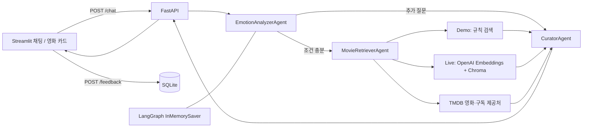
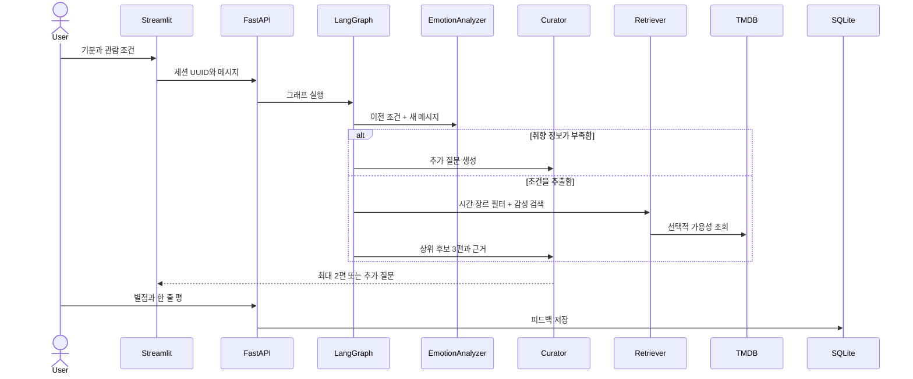

# Movie Picker 🎬

오늘의 감정과 상황을 듣고 영화를 고르는 Python 웹 애플리케이션입니다. Streamlit UI, FastAPI 백엔드, LangGraph 3개 에이전트, 선택적 OpenAI + Chroma RAG, TMDB 연동을 포함합니다.


[추천 결과 화면](docs/demo-recommendation.png) · [시스템 구조도 JPG](docs/architecture.jpg) · [서비스 흐름도 JPG](docs/flow.jpg)

## 빠른 실행 (Windows / Python 3.12)

```powershell
cd movie-picker-ai
python -m venv .venv
.\.venv\Scripts\python.exe -m pip install -r requirements.txt
Copy-Item .env.example .env
```

터미널 두 개에서 각각 실행합니다.

```powershell
.\.venv\Scripts\python.exe -m uvicorn app.api:app --host 127.0.0.1 --port 8000
```

```powershell
.\.venv\Scripts\python.exe -m streamlit run streamlit_app.py --server.address=127.0.0.1
```

웹 화면: http://localhost:8501 · API 문서: http://localhost:8000/docs

설치 후에는 `powershell -ExecutionPolicy Bypass -File .\start.ps1`로 두 서버를 백그라운드 실행할 수도 있습니다. 로그는 `runtime/`에 저장되고 실행한 프로세스 번호가 출력됩니다. 종료하려면 출력된 PID를 `Stop-Process -Id <API번호>,<UI번호>`에 입력하세요. 다른 프로세스 번호는 사용하지 마세요.

이 작업 공간에서는 시스템 Python 대신 `../.tools/python/python.exe`도 사용할 수 있습니다. 실행 스크립트가 이를 자동으로 찾습니다. 이 Python 환경은 ZIP에 포함되지 않습니다.

## 기능과 사용법

- 입력: “오늘 회사에서 지쳤어. 혼자 편하게 쉬면서 105분 안에 볼 영화 추천해줘.”
- 감정·장르·동행·시간·OTT·피하고 싶은 장르를 추출합니다. 모호한 입력은 취향을 추가로 질문합니다.
- 후보 3편을 검색하고 최종 최대 2편을 추천합니다. 상영 시간과 장르 제약을 임의로 완화하지 않습니다.
- 다음 메시지 “혼자 볼 거야”에도 이전 조건이 유지됩니다. 새 이야기 버튼은 새로운 세션을 만듭니다.
- 사이드바의 명시적 시간·OTT 선택을 우선합니다. 빈 선택은 대화에서 말한 조건을 지우지 않습니다. 조건 전체 초기화는 새 이야기 버튼을 사용하세요.
- 추천 이유, 스포일러 없는 감상 팁, 검색 근거, 선택적 포스터·평점·OTT 정보를 표시합니다.
- 별점, 한 줄 평, 감정 변화(-5~5)를 SQLite에 저장합니다.

## Demo와 Live

기본 `APP_MODE=demo`는 API 키 없이 동작합니다. 한국어 규칙 분석과 자체 작성 12편 카탈로그를 사용하며, 실제 AI 의미 검색이라고 표시하지 않습니다.

Live 모드는 `.env`를 수정합니다. 실제 호출에는 API 사용 요금이 발생할 수 있습니다.

```dotenv
APP_MODE=live
OPENAI_API_KEY=your_key
OPENAI_MODEL=gpt-4.1-mini
EMBEDDING_MODEL=text-embedding-3-small
TMDB_API_KEY=your_key
TMDB_REGION=KR
```

서버를 다시 시작하면 OpenAI Pydantic 구조화 출력으로 취향을 분석하고, OpenAI 임베딩 + Chroma 영속 벡터 검색으로 후보를 찾고, 근거에 한정하여 큐레이션합니다. 최초 검색 때 영화 문서의 임베딩을 만들며 카탈로그나 임베딩 모델이 변경되면 새 컬렉션을 만듭니다. API 실패는 오류로 반환하며 데모 결과로 바꿔 표시하지 않습니다.

TMDB는 Demo에서도 키를 지정하면 사용할 수 있습니다. 제목·개봉 연도를 대조한 뒤 한국 지역의 **구독(flatrate) 제공처**를 조회합니다. 대여·구매는 구독에 포함하지 않습니다. TMDB 키가 없으면 포스터·평점·OTT를 추측하지 않습니다. OTT 제약을 지정했는데 가용성을 확인할 수 없으면 영화를 추천하지 않고 안내합니다. 일부 작품은 원제 표기 차이로 조회되지 않을 수 있습니다. 시청 정보는 TMDB/JustWatch 링크에서 최종 확인하세요.

## 구조





## API

`GET /health`는 상태·실제 실행 모드를 반환합니다.

`POST /chat` 요청 예시:

```json
{"session_id":"943279f3-a680-4cba-ad60-02f69796228c","message":"지쳐서 편하게 쉬고 싶어","max_minutes":105,"providers":[]}
```

`POST /feedback` 요청 예시:

```json
{"session_id":"943279f3-a680-4cba-ad60-02f69796228c","movie_id":"little-forest","rating":5,"comment":"편안했어요","mood_change":2}
```

## 테스트 / Docker

```powershell
.\.venv\Scripts\python.exe -m pytest -q
docker compose up --build
```

Docker도 먼저 `.env`가 필요합니다. UI: http://localhost:8501. `movie-data` 볼륨에 피드백과 Chroma 인덱스가 보관됩니다. `.env`는 이미지와 Git에 포함하지 않습니다. 검증 결과는 [VALIDATION.md](VALIDATION.md)를 참고하세요.

## 구현 범위와 데이터

- 에이전트 간 협업은 LangGraph의 명시적 상태 전달입니다. 자율 ReAct, 표준 A2A, MCP 서버는 구현하지 않았습니다. 외부 연동은 일반 HTTP입니다.
- 원본 저작물의 평론·명대사를 수집하지 않았으며 자체 작성 요약과 감상 노트를 사용합니다. 각 영화 문서 하나를 검색 단위로 사용합니다. 더 큰 데이터셋의 수집·리뷰 청킹은 확장 항목입니다.
- 대화 메모리는 프로세스 내 저장이며 서버 재시작 시 사라집니다. 피드백과 벡터 인덱스는 디스크에 저장합니다. 피드백 기반 자동 학습과 선제 알림은 포함하지 않습니다.
- 요청은 체크포인터 일관성을 위해 직렬 처리합니다. 다중 사용자 운영에는 인증·세션 접근 제어, DB 체크포인터, 요청 제한과 병렬 처리 설계가 필요합니다. 기본 바인딩과 Compose 포트는 localhost입니다.
- Live에서는 입력과 선호 조건이 OpenAI에 전송됩니다. TMDB에는 영화 검색어를 전송합니다. 키와 개인정보를 저장소에 올리지 마세요.
- Python/Streamlit 서버를 실행하는 프로젝트로, 정적 웹 호스팅만으로 실행할 수 없습니다.

## 공식 구현 참고자료

[OpenAI 구조화 출력](https://developers.openai.com/api/docs/guides/structured-outputs) · [LangGraph 메모리](https://docs.langchain.com/oss/python/langgraph/add-memory) · [Chroma 검색](https://docs.trychroma.com/docs/querying-collections/query-and-get)

TMDB / JustWatch 데이터 사용 시 각 서비스의 이용 및 출처 표시 조건을 확인하세요. This product uses the TMDB API but is not endorsed or certified by TMDB.
